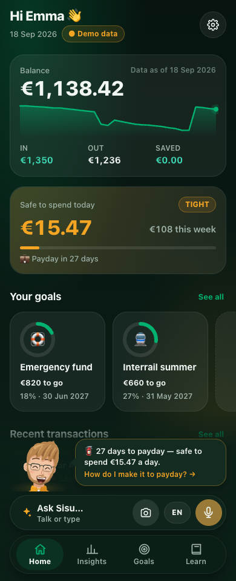
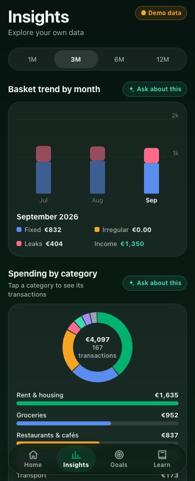
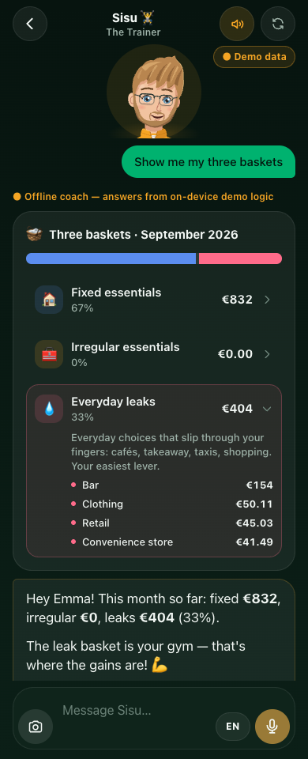

# Rahakamu

**Talk with your money.** A Junction 2026 prototype for S-Pankki's Personal Economic
Trainer challenge, shared for organisers and reviewers. Sisu (the trainer) and
Aava (the mentor) explain spending through three baskets: fixed essentials,
irregular essentials and flexible spending.

<p>
  
  
  
</p>

*Home, spending insights and a conversation with Sisu.* Screenshots use synthetic demo data and the offline scripted coach.

- Six demo customers, including Joni, with different financial situations.
- English, Finnish and Swedish (`en` / `fi` / `sv`).
- Data-driven recovery support: prioritise repairing a negative balance or stabilising
  negative cash flow before ordinary savings coaching. The situation comes from the
  numbers, not a hard-coded customer identity.
- Interactive charts, goals, lessons and chat widgets.

## Run the offline demo

Use **Node.js 22 LTS (22.13 or newer) or 24 LTS (24.3 or newer)** and npm:

```bash
cd mobile
npm ci
npm run web:mock
```

Open the local web address printed by Expo. This mode uses deterministic, bundled
fixtures and a scripted coach: **no challenge dataset, backend or model API key is
needed**. Installing dependencies requires internet access; offline here means the
app does not depend on a running backend or model service.

## Use the real backend

The FastAPI backend computes analytics from challenge data using DuckDB. Supply your
own authorised challenge files in the root `data/` directory, following
[Data sources](docs/DATA_SOURCES.md) and the [backend guide](backend/README.md).
Start the backend, then run `npm run web` in `mobile/`. See the
[mobile guide](mobile/README.md) for API URL configuration and fixture fallback behaviour.

The backend has a deterministic fallback coach; live model-backed chat additionally
requires your own provider configuration and credentials, described in the
[agent guide](backend/app/agent/README.md). Neither challenge data nor secrets are
shared in this repository. Do not upload them.

## Project map

```text
mobile/                 Expo app, offline fixtures and lightweight checks
backend/                FastAPI, DuckDB analytics, agent and backend tests
docs/                   Specification, data sources, safety and integration notes
pitch/                  Pitch and demo script (HTML slides are legacy material)
design/                 Brand and character assets, including labelled legacy artwork
e2e/                    API smoke and browser test instructions
scripts/                Local development and check helpers
deploy/coming-soon/      Static branding fixture; no deployment configuration
```

Start with the [specification](docs/SPEC.md), [judging guide](docs/JUDGING_CRITERIA.md),
[demo script](pitch/DEMO_SCRIPT.md), [privacy and safety notes](docs/PRIVACY_AND_SAFETY.md)
and [test guide](e2e/README.md). The [S-mobiili integration plan](docs/S-MOBIILI_INTEGRATION.md)
is a proposal, not a deployed bank integration. Older `spankkibot` technical identifiers
remain unchanged.

**This is a hackathon prototype, not an official bank product or personalised financial
advice.** Use demo or otherwise authorised data only; production authentication and
bank integration require further work.
