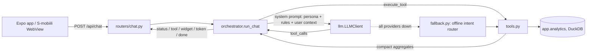

# Rahakamu AI agent

The agent lets an S-Bank customer *talk with their own money* through one of two human
coach characters: **Sisu, the Trainer** (energetic, direct, sporty coaching metaphors) or
**Aava, the Mentor** (calm, curious, explains the why). It speaks English, Finnish and
Swedish and answers in the language of the user's latest message. It runs as an LLM tool loop
over the customer's real transactions and streams answers, interactive widgets and the
character's mood to the app over Server-Sent Events.



## Why it is built this way

| Goal | How |
|---|---|
| **Numbers you can trust** | The model never sees raw rows and never writes SQL. It picks a tool and parameters from closed enums (categories, baskets, `period="last_month"`), and the analytics compute the figures. Rule #1 of the prompt bans numbers that did not come from a tool. `evals/` checks this automatically. |
| **Privacy by design** | `ToolResult.llm_payload` holds compact aggregates only: totals, top groups, at most 10 slim rows. The model never sees other customers' data. |
| **Generative UI** | Every tool also returns typed widgets (SPEC §5.3) that the app renders natively, inline. The model decides *what* to look at; the code decides *how* to show it. |
| **Pedagogy** | Both personas use the same tools and rules but teach differently. Sisu turns insights into a concrete challenge (a commitment device). Aava explains *why*, then asks one reflective question (Socratic). Answers relate spending to the **three baskets** and may end with a one-line 💡 concept. |
| **Transparency** | `done.sources` = "Based on N transactions · period · tools", so users can see what an answer rests on. |
| **Consent for writes** | `create_goal` / `update_goal` only write when the user's latest message explicitly confirms. Otherwise they return an `action_buttons` proposal. `plan_goal` never writes. |
| **Resilience** | Provider chain with timeouts. A connection error or 5xx is retried once; a timeout or `429` is not. A failed provider rests for a few seconds (`Retry-After` on a 429, else `LLM_SHORT_COOLDOWN_S`); the long `LLM_UNHEALTHY_COOLDOWN_S` breaker opens only after `LLM_BREAKER_THRESHOLD` failures in a row, and a success resets the count. `403 subscription_required` means the provider is unavailable for 10 min, with no retry. If the stream breaks after text was already shown, the answer ends with a short "connection dropped" note and `done.truncated = true`. If every provider is down, or `LLM_OFFLINE=1` is set, an offline router answers with the same tools and widgets. If the model returns an empty answer after tools ran, the answer is composed from the tool results. |
| **Safety net** | `guardrails.py` checks every model-written answer before `done`: euro amounts stated although no data tool ran and which are in neither the user context nor the conversation, and advice to buy or sell a named security. Streamed text cannot be taken back, so a hit appends a short correction in the user's language and sets `done.guardrail`. No tool takes a customer id from the model; the id always comes from the request. A photo is sent to the model for the first 2 tool rounds only. Requests are bounded by the limits in `backend/README.md`. |
| **Speed** | Nemotron thinks while *choosing tools* (date maths, filters) but writes the final answer without a reasoning pass. Median answer is about 1.4 s end to end. Reasoning text is never shown; it only switches the status to "thinking". |
| **Portability** | Uses the OpenAI-compatible protocol with an open-weights model, so it can be self-hosted (EU) or swapped by changing env vars. The agent is stateless: every request carries the visible conversation, so there is no session store. |

## Modules

| File | Responsibility |
|---|---|
| `settings.py` | Reads env / `app.config` / `.env` once: provider chain, `AS_OF_DATE`, flags. The API key is excluded from `repr`. |
| `llm.py` | `LLMClient.stream()` with failover, `ToolCallAccumulator` (stitches streamed tool-call deltas by `index`), `ThinkTagFilter` (strips inline `<think>` blocks), `llm_status()` for health checks. |
| `personas.py` + `../data/personas.json` | Persona registry. The JSON holds voice and pedagogy rules, example phrasing in en/fi/sv, greetings, 6 starter chips per locale, TTS `{pitch, rate}`, colours, status labels and fallback phrases. |
| `vocab.py` | Shared vocabulary for the LLM and offline paths: categories, baskets, sub-categories mapped to MCCs (taxi → 4121), en/fi/sv synonyms, named periods relative to AS_OF, money and period formatting. |
| `tools.py` | 17 OpenAI tool schemas + executors → `ToolResult(llm_payload, widgets, sources, summary, raw)`. Also holds persona/locale status labels and the lesson lookup (`lessons.json`, with a built-in fallback). |
| `prompts.py` | System prompt = persona block + 11 numbered rules + compact user context (name, age, today, balance, payday, safe-to-spend, basket shares, goals) + a vision note when an image is attached. |
| `orchestrator.py` | `run_chat(req)`: async generator of SSE events, at most 6 tool rounds (the last round is forced to answer), per-request tool cache, preamble handling, offline switch. |
| `lang.py` | `norm_locale` (anything → en/fi/sv) and a small dependency-free language detector: function words + orthographic cues, falling back to the app locale for "ok"-style messages. Decides the turn language. |
| `guardrails.py` | Post-answer checks (unverified amounts, investment picks) and their en / fi / sv correction texts. |
| `fallback.py` | Offline intent router (en + fi stems + sv phrases, amounts such as `12 000 €` / `12k` / `300 euroa` / `300 euro` — `12 000 kr` is ignored, not euros —, percentages, periods, deadlines such as "by June" / "kesäkuuhun mennessä" / "senast i juni" / "om 18 månader", "ja, skapa målet") and persona-styled templates in all three languages. |
| `followups.py` | `done` extras: mood (concerned > celebrate > happy > neutral), 3 follow-up chips, merged sources. |
| `events.py` | `ChatRequest` model, SSE event constructors, `parse_sse()` for clients and tests. |
| `evals/` | `questions.json` (33 challenge questions, en + fi + sv, all 5 demo customers, 3 written in a different language than the app locale), `grounding.py` (no-invented-numbers checker), `run.py` (pass/fail table). |

## Tools → widgets

| Tool | Widget(s) |
|---|---|
| `query_spending` | `group_by=none` → `kpi`; category/basket (≤ 6 groups) → `donut_chart`; merchant/weekday/hour → `bar_chart`; month/week/day → `line_chart` |
| `search_transactions` | `transaction_list` (`sort="largest"` leaves out income and savings transfers) |
| `get_baskets` | `basket_breakdown` + `line_chart` (leaks per month) |
| `safe_to_spend` | `safe_to_spend` |
| `simulate_what_if` | `what_if` with `slider {category\|basket, min:-100, max:0, value}` |
| `plan_goal` | `goal_plan` + `action_buttons` (`create_goal` payload, plus "try a later deadline" when relevant) |
| `create_goal` / `update_goal` | confirmed → `kpi` + `open_tab goals`; not confirmed → `action_buttons` proposal |
| `list_goals` | `kpi` (progress %) + `action_buttons` |
| `spender_profile` / `benchmarks` / `survival_plan` / `home_readiness` | widget of the same name (`benchmark` for benchmarks) |
| `recurring_payments` | `kpi` + `bar_chart` |
| `get_overview` | `kpi` + basket `donut_chart` |
| `explain_concept` | `lesson` (with quiz) |
| `render_chart` | `bar_chart` / `line_chart` / `donut_chart` built from numbers already returned by tools |

## SSE protocol (`POST /api/chat`)

```
event: status   data: {"state":"thinking","label":"Sisu is warming up…"}
event: status   data: {"state":"tool","label":"Checking your taxi spending…"}
event: widget   data: {"id":"w_07fe…","type":"kpi","data":{"items":[…]}}
event: tool     data: {"name":"query_spending","args":{"subcategory":"taxi","period":"last_month"},"summary":"taxi · Aug 2026: 0.00 € (0 tx)"}
event: status   data: {"state":"writing","label":"Sisu is writing your plan…"}
event: token    data: {"text":"You spent **0 €** on taxis last month…"}
event: done     data: {"message_id":"msg_…","sources":{"tx_count":0,"period":"Aug 2026","tools":["query_spending"]},"suggestions":[…3],"mood":"happy"}
```

Request: `{"customer_id","persona":"sisu|aava","locale":"en|fi|sv","messages":[{"role","content"}],"image_base64"?}`.
Unknown customers get `404` before the stream starts. `POST /api/chat/feedback`
`{message_id, rating: 1|-1, comment?}` is stored through `app.store.save_feedback`, or in
`backend/feedback.jsonl` if the store is unavailable.

**Vision:** `image_base64` (raw base64 or a data URI) is sent to Nemotron VL as an
`image_url` part. The model reads the price tag or receipt, then calls `safe_to_spend`
and says whether the item fits. Offline, the app asks the user to type the price instead.

## Configuration

| Env | Default | Meaning |
|---|---|---|
| `VERDA_INFERENCE_KEY` | — | API key (never logged or returned) |
| `LLM_PRIMARY_BASE_URL` / `LLM_PRIMARY_MODEL` | — | Primary provider (Nemotron 3.5 Super VL) |
| `LLM_FALLBACK_BASE_URL` / `LLM_FALLBACK_MODEL` | — | Secondary provider |
| `LLM_OFFLINE` | `0` | `1` forces the rule-based path (a full demo with no LLM) |
| `LLM_THINKING` | `1` | Reasoning pass during tool selection (hybrid models) |
| `LLM_TIMEOUT_S` / `LLM_FIRST_TOKEN_TIMEOUT_S` | `45` / `25` | Request / first-chunk timeouts |
| `LLM_UNHEALTHY_COOLDOWN_S` | `60` | Circuit-breaker cooldown after `LLM_BREAKER_THRESHOLD` consecutive failures |
| `LLM_SHORT_COOLDOWN_S` | `5` | Rest after a single failure (a 429 uses `Retry-After`, clamped to 1–30 s) |
| `LLM_BREAKER_THRESHOLD` | `3` | Consecutive failures before the long cooldown |
| `LLM_MAX_TOOL_ROUNDS` | `6` | Tool-loop bound |
| `AS_OF_DATE` | `2026-09-18` | Simulated "today" |

## Quality checks

```bash
cd backend
uv run pytest tests/test_agent*.py tests/test_i18n.py -q   # agent unit tests + languages
uv run python -m app.agent.evals.run --show           # real LLM (33 questions)
uv run python -m app.agent.evals.run --offline        # offline router: 33/33 pass
```

Each eval checks that the expected tool was called, that every number is grounded in
tool payloads or the user context (within rounding, allowing simple derived values such
as ×12 or sums), the length (≤ 150 words), that no reasoning or tool JSON leaked, that
the `done` event is well formed, that the answer is in the expected language (`lang`) and
that no animal wording appears (`human`: Sisu and Aava are human coaches).

## Languages

* **Turn language.** `orchestrator.turn_language` = `lang.detect_language(latest user
  message, request locale)`. A Swedish question in a Finnish-language app gets a Swedish
  answer; "ok" or "300 €" falls back to the app locale. That one value drives the system
  prompt's LANGUAGE rule, status labels, widget titles, analytics texts inside widgets
  (via `app.i18n.use_locale` in `execute_tool`), follow-up chips and the offline answer.
* **Swedish** uses Finland-Swedish banking words (lön, hyra, räkningar, sparmål, saldo) and
  the basket names *fasta måsten / oregelbundna måsten / vardagsläckor*.

## Extending

1. **Add a tool:** add a schema with `_fn(...)` in `tools.py`, an `async` executor that
   returns a `ToolResult`, an entry in `EXECUTORS`, and status labels in `_STATUS`.
   Optionally add a fallback template (`fallback._TEMPLATES`), closers and follow-up
   chips. An `assert` fails at import if a schema has no executor.
2. **Add a persona:** add an entry to `data/personas.json` (the app reads the same file
   through `GET /api/personas`) and allow its id in `events.ChatRequest`.
3. **Add a language:** add the code to `lang.LOCALES` (with function words), locale keys
   to `personas.json`, `lessons.json` and `mcc.json`, labels to `vocab.py`, a branch to
   each `tr(...)` / `pick(...)` call and fallback template, and the name to
   `prompts.LANGUAGE_NAMES`.
