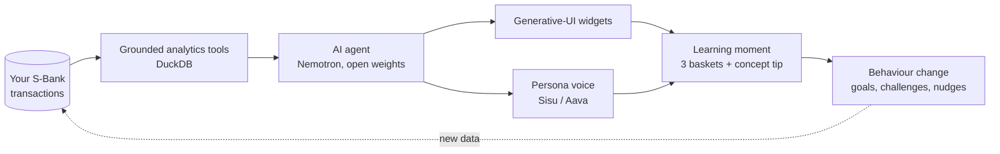
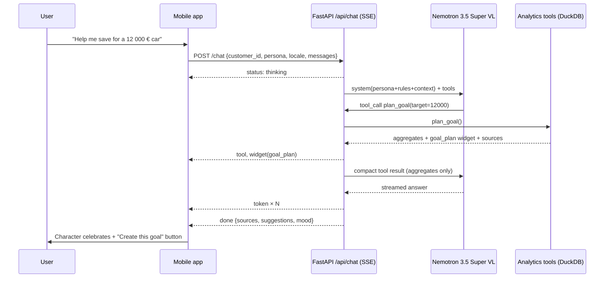
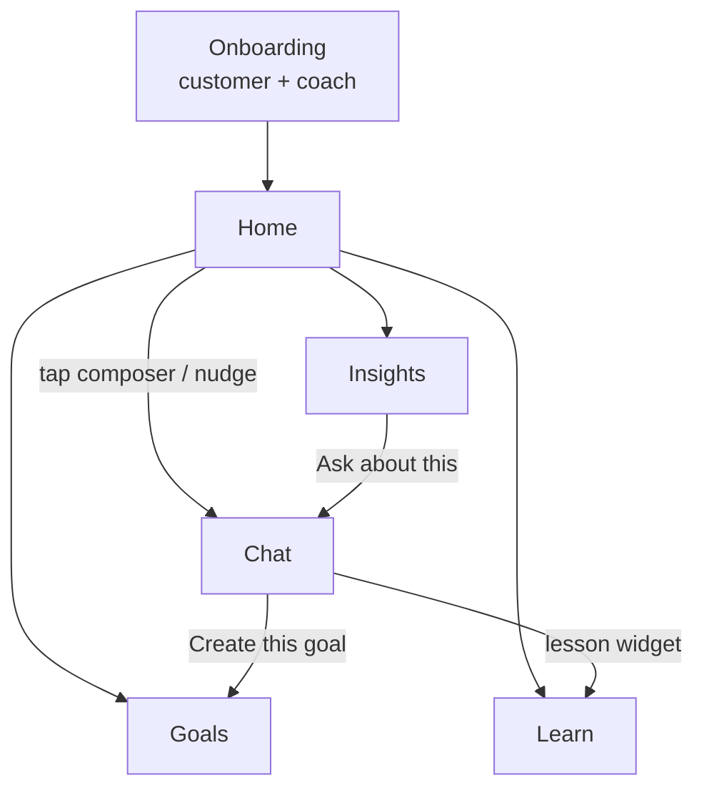

# Rahakamu vs. the Judging Criteria

> **One-line pitch:** Rahakamu turns your own S-Bank transactions into a personal money trainer. You talk with your money through two AI characters, **Sisu** 🐻 (the trainer) and **Aava** 🦉 (the mentor). Every answer is grounded in your real numbers, framed in the **three baskets**, and drawn as an interactive widget right inside the chat.

The five criteria carry equal weight (20 % each). This page maps each one to concrete features, says where to see each feature in the app, and lists the evidence a judge can check. Demo steps refer to the 3-minute script in [`DEMO_SCRIPT.md`](../pitch/DEMO_SCRIPT.md) <!-- VERIFY: step numbers once DEMO_SCRIPT.md is final -->.

| # | Criterion | Our headline answer | Strongest proof point |
|---|---|---|---|
| 1 | Impact on financial literacy | One mental model, **the three baskets**, shows up everywhere. It is taught through the user's *own* data | Basket meter → chat explanation → Money Gym lesson unlocked by your own leak basket |
| 2 | Originality of AI integration | Tool-calling agent + **generative UI** + two pedagogical personas + vision + voice | "Help me save for a 12 000 € car" returns a live goal plan with cuts you can create in one tap |
| 3 | Clarity of mobile UX | One home screen answers "how am I doing?", and the character is always one tap away | Safe-to-spend card + character dock on the home screen |
| 4 | Feasibility | Runs today on the full 3.6 M-row dataset with DuckDB and an open-weights model, and works offline | `uv run pytest`, eval runner, offline mode demo |
| 5 | Potential to integrate into S-mobiili | Stateless REST + SSE + widget protocol, plus an embeddable web build and native-module path | [`S-MOBIILI_INTEGRATION.md`](S-MOBIILI_INTEGRATION.md): 3 integration paths |

---

## 1. Impact on financial literacy (pedagogy)

**What judges look for:** Does the product *teach* rather than just report? Is there a clear, repeatable mental model? Does it change behaviour, especially for young adults? Is the advice responsible?

### Our pedagogy in one picture: the three baskets

| Basket | Meaning | Examples (from MCC + category rules) | Colour |
|---|---|---|---|
| **Fixed** | Mandatory & regular | Rent/housing, utilities, everyday groceries, public transit, detected recurring bills | `#5B8DEF` |
| **Irregular** | Mandatory but irregular | Health, dentist, repairs/hardware, large home & tech, car costs | `#F5A524` |
| **Leak** | Everyday spending that slips through your fingers | Restaurants, cafés, bars, taxis, convenience kiosks, entertainment, lifestyle, travel | `#FF6B8A` |

Every basket has a plain-language `why` explanation that comes from the same classification function the analytics use (`app.analytics.baskets`). We never show a number we cannot explain.

### Features that address it

| Feature | Pedagogical technique | Where to see it |
|---|---|---|
| **BasketMeter** (home) | One consistent mental model; tap to see why each transaction landed in its basket | Home → Basket meter → tap a segment |
| **"💡 Concept" tip** at the end of AI answers | Micro-learning at the moment of relevance (just-in-time teaching) | Chat → any spending question |
| **Two personas, two teaching styles** | Sisu: goal-setting, challenges, streaks (behavioural activation). Aava: explains *why* and asks one reflective question (Socratic method) | Settings / onboarding → switch character, ask the same question |
| **Money Gym** micro-lessons + quizzes, unlocked by your own data | Personal relevance: the lesson on "latte leaks" appears because *your* leak basket is high | Learn tab <!-- VERIFY: data-driven unlock implemented --> |
| **What-if slider** | Learning by experiment: drag "Restaurants −20 %" and watch 12-month savings update live | Chat → "How much could I save if I reduced dining out by 20 %?" |
| **Goal plan with realistic cuts** | Turns an abstract goal into concrete monthly actions, taken from the leak basket first | Chat → "Help me save for a car that costs 12 000 €" |
| **Safe-to-spend / survival plan** | Teaches cash-flow thinking: bills before payday + buffer = what is really free | Home → Safe-to-spend card; chat → "How do I survive this month with 300 €?" |
| **Spender profile archetypes** | Self-awareness through a non-judgemental identity ("Weekend treater", "Squirrel saver") | Insights → Spender profile |
| **Peer benchmarks** | Social norms with context (your age group in the dataset, Statistics Finland reference where available) | Insights → Benchmarks |
| **Proactive nudges** | Celebrate wins, warn early, suggest a next step | Home → character speech bubble |

### Responsible teaching
- Investing content is **general education only**, never personalised investment advice. It always mentions risk and points to S-Bank advisors (see [`PRIVACY_AND_SAFETY.md`](PRIVACY_AND_SAFETY.md)).
- Tone is coaching, not shaming. "Leak" means money that slips away unnoticed; it is not a moral judgement.

### Demo moments
1. Home: point at the BasketMeter. "Emma's leak basket is 38 % of her spending this month." <!-- VERIFY: actual number for CUST05020 -->
2. Chat with Aava: "Why is my leak basket so big?" → basket_breakdown widget + Socratic question + 💡 tip.
3. Learn tab: the matching lesson and quiz.

### Evidence
| Evidence | Where |
|---|---|
| Basket classification unit tests (each MCC/category rule) | `backend/tests/` <!-- VERIFY: test file names --> |
| Lessons and quizzes content | `backend/app/data/lessons.json` |
| Proposed pilot KPI: literacy quiz score before/after | [`S-MOBIILI_INTEGRATION.md` § Rollout](S-MOBIILI_INTEGRATION.md#8-rollout-plan--kpis) |

---

## 2. Originality of AI integration

**What judges look for:** Is AI essential to the product rather than bolted on? Is the integration novel, trustworthy and well engineered?

### What makes it more than "a chatbot on top of a bank"

| Capability | What it does | Why it is original |
|---|---|---|
| **Tool-calling agent over the user's own data** | 17 typed tools (query_spending, safe_to_spend, plan_goal, simulate_what_if, survival_plan, home_readiness, render_chart, explain_concept, ...) wrap deterministic analytics | The LLM never does arithmetic and never sees raw SQL; numbers come from tools only |
| **Generative UI** | Tools emit typed widgets (`kpi`, `bar_chart`, `line_chart`, `donut_chart`, `basket_breakdown`, `what_if`, `goal_plan`, `survival_plan`, `home_readiness`, `spender_profile`, `benchmark`, `lesson`, `action_buttons`, ...) that the app renders natively inside the conversation | The answer *is* an interactive app surface. The what-if slider re-runs the simulation live without another LLM call |
| **MyData query engine** | `query_spending(group_by=hour/weekday/merchant/...)` + `render_chart` lets the model answer questions nobody pre-built ("When in the week do I spend most on food?") | Open-ended exploration that stays safe and parameterised |
| **Two personas, one toolset** | Sisu 🐻 (trainer: reps, streaks, challenges) and Aava 🦉 (mentor: why, analogies, reflection) | Persona = *pedagogy*, not just a skin; the user picks how they learn |
| **Animated characters driven by the agent** | SSE `status` → thinking/talking; `done.mood` → happy/concerned/celebrate animation | Emotional feedback loop tied to the user's actual financial state |
| **Vision: "Can I afford this?"** | Snap a price tag or receipt → Nemotron VL reads it → checks safe-to-spend and goal impact | Camera to grounded decision in one step <!-- VERIFY: vision path wired end-to-end --> |
| **Voice in/out** | Hold to talk (STT); persona-tuned TTS (Sisu pitch 0.9 / rate 1.05, Aava 1.1 / 0.95) | Hands-free, accessible, in fi/en <!-- VERIFY: sv voice --> |
| **Confirm-before-write actions** | The agent *proposes* "Create goal 'Car' 12 000 € by 2027-06" as an `action_buttons` widget; the app writes only on tap | Agentic but user-in-control |
| **Transparent sources** | Every answer ends with "Based on N transactions · period", expandable to show the tools used | Explainable AI by default |
| **Open-weights, self-hostable model** | Nemotron 3.5 Super VL via an OpenAI-compatible API, with a provider chain and offline fallback | Bank-grade deployability (EU hosting, no vendor lock-in) |

### Demo moments
- "Help me save for a car that costs 12 000 €" → goal_plan widget → tap **Create this goal** → it appears in the Goals tab.
- "How much could I save if I reduced dining out by 20 %?" → drag the what-if slider live.
- Camera → photo of a price tag → "Can I afford this?" <!-- VERIFY -->
- Switch Sisu ↔ Aava on the same question to show the two pedagogies.

### Evidence
| Evidence | Where |
|---|---|
| Agent eval suite: 15+ scripted questions from the challenge brief with expected tool calls | `backend/app/agent/evals/`, run `uv run python -m app.agent.evals.run` |
| Eval pass rate | **TBD** <!-- VERIFY: fill in e.g. "15/16 pass on primary model, 14/16 on offline fallback" --> |
| Widget protocol spec | [`SPEC.md` §5.3](SPEC.md), [backend guide](../backend/README.md) |
| Tool → widget mapping | `backend/app/agent/tools.py` |

---

## 3. Clarity of mobile UX

**What judges look for:** Can a first-time user understand their situation in seconds? Is the design native-feeling, accessible and polished?

### Design principles
1. **One glance, one answer.** The home screen answers "How am I doing, and what can I spend?" above the fold.
2. **The coach is always there.** The character docks above the tab bar with a speech bubble cycling personal nudges. Tap it to start talking.
3. **Show, then tell.** Answers lead with a widget, and the text stays at 120 words or fewer.
4. **Premium S-Bank feel.** Dark S-green theme (`#07140F` background, `#00B26F` primary), glass surfaces, tabular money numbers, spring animations, haptics.

### Screen map

| Screen | Purpose | Key components |
|---|---|---|
| **Onboarding** | Pick a demo customer + pick your coach | Persona picker, character preview |
| **Home** (hero) | Status at a glance | Greeting · BalanceCard (30-day sparkline) · SafeToSpendCard · GoalCarousel · BasketMeter · Recent transactions · CharacterDock + composer (type / hold-to-talk / camera) |
| **Chat** | Conversation with generative UI | Large animated character, status line, widgets inline, suggestion chips, sources chip, 👍/👎, read-aloud |
| **Insights** | MyData explorer | Basket trends, spender profile, benchmarks, free filters |
| **Goals** | Plan and track | Progress rings, create/plan goal |
| **Learn** | Money Gym | Micro-lessons, quizzes, streak |
| **Settings** | Control & transparency | Language (en/fi), voice, character, data & privacy explainer |

### Accessibility & inclusiveness
- Dynamic type-friendly sizes (34/22/17/15/13), high contrast on the dark theme, plus a light theme through tokens.
- Voice input/output, so the app is usable without reading or typing.
- Colour is never the only signal: baskets have labels and emoji, and status has text.
- i18n: English and Finnish UI. The agent replies in fi/en/sv.
- See [`PRIVACY_AND_SAFETY.md` § Accessibility](PRIVACY_AND_SAFETY.md#7-accessibility).

### Demo moments
- Open the app on Emma → read the safe-to-spend card in under 5 seconds.
- Hold the mic: "Paljonko käytin ravintoloihin viime kuussa?" → Finnish answer + bar chart.

### Evidence
| Evidence | Where |
|---|---|
| Runs on iOS, Android and web (390×844 target; 480 px centred column on desktop) | `mobile/` (Expo SDK 58) |
| Mock mode for UI review without a backend | `EXPO_PUBLIC_MOCK=1` |
| Screenshots | `README.md` <!-- VERIFY: add screenshots --> |

---

## 4. Feasibility

**What judges look for:** Does it actually work on the provided data? Could a bank realistically build and run it?

### What runs today

| Layer | Technology | Status |
|---|---|---|
| Data | Provided synthetic dataset: **3.6 M transactions, 5 100 customers**, 2024-10 → 2026-09, converted to Parquet | ✅ |
| Analytics | DuckDB over Parquet, pure Python functions, parameterised queries (no LLM-written SQL) | ✅ <!-- VERIFY: p95 latency --> |
| API | FastAPI, REST + SSE, stateless agent, SQLite only for goals/feedback | ✅ |
| AI | Nemotron 3.5 Super VL (open weights) via OpenAI-compatible API; primary → fallback provider chain; 1 retry; timeouts | ✅ |
| Offline fallback | Keyword intent router (en + fi) → same tools → templated persona answers + widgets | ✅ The demo works without any LLM |
| Mobile | Expo SDK 58, React Native, TypeScript strict; iOS/Android/web from one codebase | ✅ |

### Why a bank can run this
- **No exotic infrastructure:** one Python service plus an inference endpoint. DuckDB can be swapped for the bank's warehouse behind the same function signatures.
- **Open-weights model:** can be self-hosted on S-Bank or EU infrastructure. There is no dependency on a US hyperscaler API.
- **Deterministic core:** all money math sits in tested Python functions, and the LLM only orchestrates and explains. This keeps behaviour auditable and the model swappable.
- **Graceful degradation:** if the LLM is down, users still get answers and widgets.
- **Cost:** about €0.05 per monthly active user per month on hosted inference (estimate; see [cost model](S-MOBIILI_INTEGRATION.md#9-cost-estimate-per-1-000-users)).

### Evidence
| Evidence | Where / how |
|---|---|
| Backend tests | `cd backend && uv run pytest` <!-- VERIFY: count, e.g. "N tests passing" --> |
| Agent evals | `uv run python -m app.agent.evals.run` |
| Health check showing LLM availability | `GET /api/health` → `{"status":"ok","as_of","llm":{"primary":true}}` |
| Offline demo | Unset the LLM env or disconnect → chat still answers |
| Any customer works, not just the five demo personas | `GET /api/customers/CUST01234/overview` |

---

## 5. Potential to integrate into S-mobiili

**What judges look for:** Could S-Bank ship this inside its existing app without a rewrite? Are security, compliance and operations considered?

### Our answer: three integration paths, one backend

| Path | What S-Bank does | Time-to-pilot | Best for |
|---|---|---|---|
| **A. WebView embed** | Host the Expo web build; open it in a WebView inside S-mobiili; a JS bridge passes the auth token, customer context and deep links | Weeks | Fast pilot |
| **B. Brownfield React Native / Expo modules** | Embed the RN screens (Chat, widgets, characters) as native modules in the S-mobiili iOS/Android apps | 1–2 quarters | Native feel at scale |
| **C. API-only** | S-mobiili's own native UI consumes our REST + SSE + widget protocol | Depends on the S-mobiili roadmap | Full design-system control |

Full detail, covering auth (OIDC token exchange), EU data residency, PSD2/AIS multi-bank aggregation, GDPR, observability, rollout and cost, is in [`S-MOBIILI_INTEGRATION.md`](S-MOBIILI_INTEGRATION.md).

### Integration-ready design choices already in the code
- **Stateless agent:** conversation history is sent by the client, so the service scales horizontally.
- **Forward-compatible widget protocol:** unknown widget types render nothing, so the backend can ship new widgets without breaking old app versions.
- **Privacy by design:** the LLM sees aggregates only. Raw transactions stay in the analytics layer.
- **i18n** (en/fi, agent fi/en/sv) and an **S-Bank-aligned visual language**.
- **No credentials in the AI layer:** the agent receives a `customer_id` scoped by the gateway, never the user's bank login.

### Demo moment
- Open the web build at phone width in a browser and explain: "this exact build drops into an S-mobiili WebView today".

### Evidence
| Evidence | Where |
|---|---|
| API reference | [Backend guide](../backend/README.md); local OpenAPI at `http://localhost:8000/docs` |
| Architecture | [`SPEC.md`](SPEC.md) |
| Integration plan | [`S-MOBIILI_INTEGRATION.md`](S-MOBIILI_INTEGRATION.md) |
| Safety & compliance | [`PRIVACY_AND_SAFETY.md`](PRIVACY_AND_SAFETY.md) |
| Roadmap | [`ROADMAP.md`](ROADMAP.md) |
