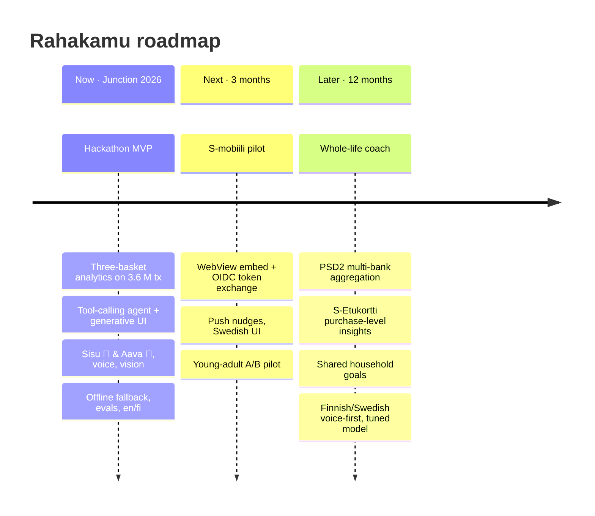

# Roadmap

Rahakamu's long-term aim: **every S-Bank customer has a personal money trainer in their pocket.** It knows their whole financial life (with consent), teaches through their own data, and nudges them at the right moment. It will never replace the human advisor, and it knows when to hand over.

---

## Now: hackathon build (Junction 2026)

| Area | Delivered |
|---|---|
| Pedagogy | Three baskets everywhere (home meter, chat, lessons); 💡 concept tips; Money Gym lessons + quizzes |
| AI | Tool-calling agent over 17 analytics tools; generative-UI widgets (charts, what-if slider, goal plan, survival plan, home readiness, profile, benchmarks); two personas; vision ("can I afford this?"); voice in/out <!-- VERIFY: final feature list --> |
| Data | DuckDB over the full synthetic dataset (3.6 M tx, 5 100 customers); any customer ID works |
| Robustness | Primary → fallback model chain, offline rule-based fallback, eval suite, tests |
| UX | Expo app for iOS / Android / web; dark S-green theme; animated characters; en/fi |
| Integration | REST + SSE + widget protocol; web build ready for WebView embedding |

---

## Next 3 months: from demo to pilot

| Initiative | Why it matters | Effort | KPI it moves |
|---|---|---|---|
| **S-mobiili WebView embed + JS bridge** (Path A) | Fastest route to real customers | M | Reach |
| **OIDC token exchange + gateway-bound customer ID** | Production auth; no credentials in the AI layer | M | Security sign-off |
| **Core-banking data adapter** | Same function signatures, real data source instead of Parquet | M | Feasibility |
| **Push nudges** ("Payday tomorrow: move 50 € to your car goal?", "Your leak basket is 20 % lower than last month 🎉") | Coaching works best at the moment of decision | M | Weekly active users, goal completion |
| **Swedish UI + agent tuning** | Serve all Finnish national-language customers | S | Reach |
| **Streaks & challenges** ("7-day no-takeaway challenge" with progress tracking) | Behavioural reinforcement (Sisu's specialty) | S | Leak-basket change |
| **Numeric-grounding verifier** | Automatically flags any number not backed by a tool | S | Answer quality |
| **CI eval gating + OpenTelemetry dashboards** | Safe iteration on prompts and models | S | Quality, reliability |
| **Advisor handoff deep links** (investing, mortgage) | Turns literacy gains into qualified advisor conversations | S | Advisor bookings |
| **DPIA, pen test, accessibility audit** | Pilot prerequisites | M | Go-live |
| **Young-adult A/B pilot (18–29)** | Measure literacy and savings impact causally | M | All pilot KPIs (see [integration doc](S-MOBIILI_INTEGRATION.md#8-rollout-plan--kpis)) |

---

## 12 months: whole-life money coach

### Data & insights
| Initiative | Description |
|---|---|
| **PSD2 / AIS multi-bank aggregation** | Link accounts in other banks with consent; same baskets, same tools. A complete picture for customers who split their banking. FIDA-ready for savings, pensions and insurance later |
| **S-Etukortti (S-Group bonus) purchase-level insights** | With consent, join S-Group loyalty receipts to card transactions: see *what* was bought, not just where. Examples: "Ready meals are 30 % of your grocery basket", "You earned 14 € Bonus this month; here is how to earn more on things you already buy". A uniquely S-Group advantage no other bank can copy |
| **Smarter recurring detection** | Subscription audit with "cancel or keep?" coaching and price-change alerts |
| **Income-volatility mode** | For gig workers and students with irregular income: smooth budgets on rolling averages |

### Life-stage modes
| Mode | What changes |
|---|---|
| **Student / Kela mode** | Recognises Kela study grant and housing supplement cycles (with consent); budgets around monthly grant dates; lessons on student loans and the student-loan compensation; summer-job saving plans |
| **First home** | Extends home readiness into a guided savings journey (ASP-style savings, equity goal, mortgage advisor handoff) |
| **Family / household** | **Shared household goals**: two S-Bank customers co-own a goal ("Summer trip 2 000 €"), each sees their contributions; household-level baskets with privacy controls on what is shared |
| **Pre-retirement** | Pension-gap education, steady-saver benchmarks (Pirjo's story) |

### AI & interaction
| Initiative | Description |
|---|---|
| **Voice-first in Finnish & Swedish** | Natural spoken conversations with low latency; persona voices tuned per language; hands-free "How much is safe to spend today?" |
| **Proactive agent** | Scheduled, rule-triggered check-ins (payday, unusual spend, goal milestone) generated by the agent and grounded in tools |
| **Model fine-tuning evaluation** | Evaluate a small fine-tuned (LoRA) open-weights model for tool selection and persona voice, trained on **synthetic conversations** generated from the synthetic dataset, never on customer chats. Compare cost, latency, eval pass rate and Finnish fluency against the base Nemotron model. Ship only if it wins on all gates |
| **On-device intent routing** | A small model on the phone for instant simple answers (balance, safe-to-spend) and privacy; cloud model for complex reasoning |
| **Richer generative UI** | Calendar widget for upcoming bills, merchant drill-downs, interactive budget builder |
| **Character growth** | Sisu and Aava "level up" with the user's streaks; optional character customisation |

### Platform
| Initiative | Description |
|---|---|
| **Native module (Path B)** | Embed RN/Expo coach screens natively in S-mobiili for full-quality voice, camera and haptics |
| **Self-hosted inference on S-Bank / EU GPUs** | Full data sovereignty and lower unit cost at scale |
| **Advisor console** | With customer consent, advisors see the coach's goal plans and summaries before a meeting, so conversations start with context |

---

## Prioritisation principles

1. **Literacy impact first.** Ship features that measurably move the pilot KPIs (savings rate, leak share, quiz scores, below-zero days).
2. **Trust before cleverness.** No feature ships without grounding, consent and an eval.
3. **S-Group advantage.** Prioritise what only S-Bank can do, such as S-Etukortti insights and household goals across S-Group membership.
4. **Open and portable.** Open-weights models, standard protocols and no lock-in.

## Explicitly out of scope

- Personalised investment recommendations or trade execution (MiFID II boundary; handled by licensed S-Bank advisors).
- Credit decisions (home readiness stays educational).
- Initiating payments from the AI layer.
- Training models on customer conversations.
