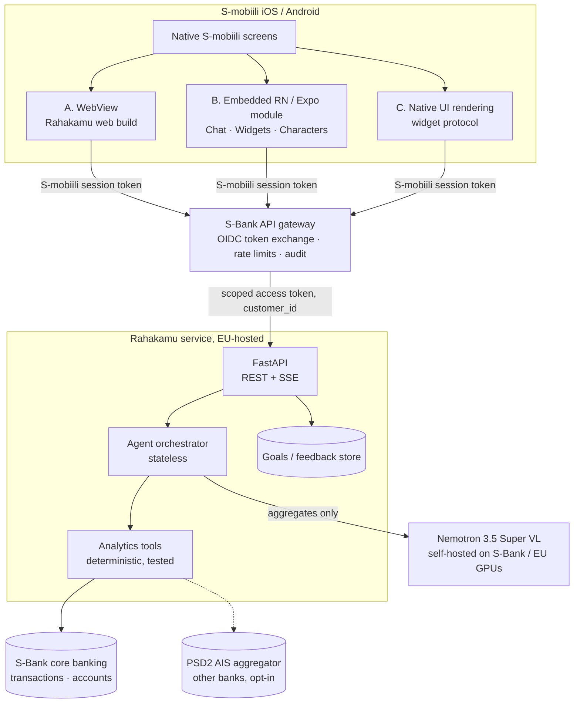
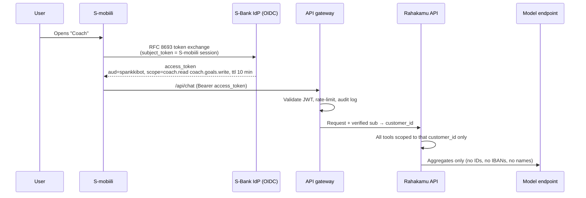
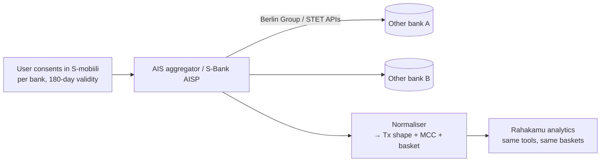
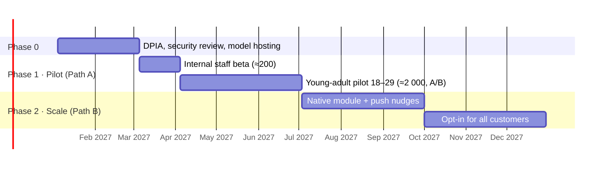

# Integrating Rahakamu into S-mobiili

Rahakamu is built to become a feature *inside* S-mobiili, not a separate app. Every surface (the home cards, the chat, the generative-UI widgets and the characters) sits on top of one stateless backend contract:

- **REST** for the customer's money state (`/api/customers/{id}/overview`, `/baskets`, `/safe-to-spend`, `/goals`, ...)
- **SSE** for the AI conversation (`POST /api/chat` → `status` / `tool` / `widget` / `token` / `done` / `error` events)
- **Widget protocol**: typed JSON (`{id, type, data}`) that any client can render. Unknown types are ignored, so the protocol stays forward compatible.

S-Bank can therefore pick how deep the integration goes. The backend does not change across the three paths below.

---

## 1. Integration paths

### Path A: Embed the web build in a WebView (fastest pilot)

The Expo app already builds for web (`npx expo export -p web`), using a max-width 480 px centred layout. S-mobiili opens it in a WebView (`WKWebView` / Android `WebView`) and talks to it through a small JS bridge.

**Bridge contract (proposed):**

| Direction | Message | Payload | Purpose |
|---|---|---|---|
| Host → Web | `spb:init` | `{accessToken, expiresAt, locale, theme, customerContext:{firstName, segment}, entry:{screen, prompt?}}` | Start a session without a login screen |
| Host → Web | `spb:token` | `{accessToken, expiresAt}` | Silent token refresh |
| Web → Host | `spb:requestToken` | `{}` | Ask for a fresh token before expiry |
| Web → Host | `spb:navigate` | `{deeplink:"smobiili://payments/new?..."}` | Hand off to a native S-mobiili feature (transfer, card settings, book an advisor) |
| Web → Host | `spb:haptic` | `{style}` | Native haptics from the web layer |
| Web → Host | `spb:close` | `{}` | Dismiss the sheet |
| Web → Host | `spb:analytics` | `{event, props}` | Forward events to the S-mobiili analytics pipeline (no PII) |

- **Deep links into Rahakamu:** `smobiili://coach?screen=chat&prompt=How%20much%20can%20I%20spend%20this%20week` → `spb:init.entry`. This lets push notifications, home-screen cards and transaction detail pages ("Ask the coach about this purchase") open the coach in context. Prompts are predefined templates keyed by ID, so no personal data goes into the URL.
- **Security:** load only the pinned S-Bank origin; disable arbitrary navigation; keep the token in memory only (no `localStorage`); CSP `connect-src` limited to the gateway.
- **Trade-offs:** fastest to ship and updates without app-store releases. Limits: voice/camera go through WebView permissions, and the feel is slightly less native.

> Status: the web build exists today. The bridge is a design and is **not implemented** in the hackathon build. <!-- VERIFY -->

### Path B: Brownfield React Native / Expo modules (native at scale)

S-mobiili embeds Rahakamu's React Native screens as a native module:

- Package `mobile/src` screens (Chat, WidgetRenderer, Character, BasketMeter, SafeToSpendCard) as an **Expo module / RN library**. They mount inside the existing iOS (`UIViewController`) and Android (`Fragment`/`Activity`) navigation using React Native's brownfield integration.
- The host supplies the token, locale and theme through initial props and a native module (`SPankkiBotHost.getAccessToken()`, `openDeepLink()`).
- Reanimated / react-native-svg characters, expo-speech, speech recognition and image picker run natively, giving full-quality voice, camera and haptics.
- Theming: our `theme/tokens.ts` maps onto S-mobiili's design tokens, so the coach adopts the host's look.
- **Trade-offs:** best UX, but it adds the RN runtime to the host app (binary size) and couples releases to the app-store cadence. Over-the-air updates (EAS Update or the bank's own CDN) can cover JS-only changes, subject to S-Bank policy.

### Path C: API-only (S-mobiili renders everything natively)

S-mobiili's own SwiftUI / Jetpack Compose UI consumes the backend directly:

- **REST** feeds native home cards: safe-to-spend, basket meter, goals, nudges.
- **SSE** chat: the native client parses `event:`/`data:` frames and renders `token` text plus `widget` payloads with native components. It starts with a core subset (`kpi`, `bar_chart`, `basket_breakdown`, `safe_to_spend`, `goal_plan`, `action_buttons`) and adds more over time. Unknown widgets are skipped by contract.
- Characters can ship as Lottie/Rive assets, or be left out at first.
- **Trade-offs:** maximum control and consistency with the S-mobiili design system, but more client work per platform.

### Comparison

| | A. WebView | B. RN / Expo modules | C. API-only |
|---|---|---|---|
| Time to pilot | **2–4 weeks** | 1–2 quarters | 2+ quarters |
| Native feel | Good | **Excellent** | **Excellent** |
| Voice / camera / haptics | Via bridge / WebView permissions | Native | Native (rebuilt) |
| Release cadence | Web deploy, instant | App store + OTA for JS | App store |
| Host app impact | Minimal | RN runtime added | None (new native code) |
| Reuse of hackathon code | ~100 % | ~80 % | Backend 100 %, UI 0 % |
| **Recommended for** | **Pilot (phase 1)** | **Scale (phase 2)** | Long-term option |

---

## 2. Authentication & authorisation

**Principle: the AI layer never sees credentials.** The user is already strongly authenticated in S-mobiili (bank ID / PIN / biometrics). Rahakamu reuses that session through a standard token exchange.

| Control | Design |
|---|---|
| Token | OAuth 2.0 / OIDC, **RFC 8693 token exchange** from the S-mobiili session; audience `spankkibot`; short TTL (5–10 min) plus silent refresh |
| Scopes | `coach.read` (analytics + chat), `coach.goals.write` (goal CRUD), `coach.aggregation.read` (PSD2 data, only with consent) |
| Customer binding | `customer_id` comes **only** from the validated token `sub` at the gateway, never from the request body or the LLM. *(The hackathon build accepts `customer_id` in the request for demo purposes.)* <!-- VERIFY --> |
| Writes | The agent only *proposes* (`action_buttons`). The client performs the write on user tap, using the user's token |
| Money movement | **Out of scope.** The coach can deep-link to S-mobiili's native payment flow, but it never initiates payments itself |
| Step-up | Sensitive future actions (e.g. adding external bank accounts) trigger S-mobiili's native step-up authentication |

---

## 3. Data residency & model hosting

| Concern | Approach |
|---|---|
| Model | **Nemotron 3.5 Super VL**, open weights, served through an OpenAI-compatible API (vLLM / NVIDIA NIM / TensorRT-LLM) |
| Where it runs | Hackathon: EU-hosted inference endpoint (Verda, Finland) <!-- VERIFY: provider region -->. Production: **self-hosted on S-Bank or S-Group infrastructure or an EU sovereign GPU cloud**. No data leaves the EU/EEA |
| Vendor lock-in | None. The provider chain (`LLM_PRIMARY_*`, `LLM_FALLBACK_*`) can point to any OpenAI-compatible endpoint, and models can be swapped without code changes |
| DORA (EU 2022/2554) | Self-hosting avoids a new critical ICT third-party dependency. If a hosted provider is used, it goes into the ICT third-party register, with exit plans built on the open-weights portability |
| Outage | The offline rule-based fallback keeps the coach working (reduced eloquence, same numbers) |

---

## 4. PSD2 / AIS multi-bank aggregation (extension)

Many young adults hold accounts in several banks. A coach that sees only the S-Bank account misses part of the picture. Under PSD2, S-Bank can act as an **Account Information Service Provider (AISP)**, directly or through a licensed aggregator, and bring in other banks' transactions with explicit customer consent.

- **Same data model:** external transactions are normalised to the existing `Tx` shape and run through the same `classify()` basket function, so every tool, widget and lesson works unchanged.
- **Consent UX:** per-bank toggle, a visible list of "linked accounts" in Settings, one-tap revoke, and an expiry reminder before 180-day re-consent.
- **Provenance:** sources chip shows "Based on 120 transactions · S-Bank + 1 linked account".
- **Store:** linked-account metadata only. The hackathon store reserves a `linked accounts` table. <!-- VERIFY: implemented or schema-only -->
- **Forward look:** the design also fits the upcoming FIDA (Financial Data Access) framework, which would extend this to savings, pensions and insurance data.

---

## 5. GDPR & data protection

| GDPR principle | How Rahakamu implements it |
|---|---|
| **Lawful basis** | Contract performance / legitimate interest for in-app insights on the customer's own data. Explicit consent for PSD2 aggregation, voice and camera |
| **Data minimisation** | Tools return **compact aggregates** to the LLM (`llm_payload`). Raw transactions, account IDs, IBANs and counterparties never enter the prompt. Widgets with transaction details go straight from the analytics layer to the client and bypass the model |
| **Purpose limitation** | Data is used only to coach this customer. **No training on customer data**, and no reuse for marketing or credit decisions |
| **Storage limitation** | Chat history lives on the device and is sent per request (the agent is stateless). Server keeps goals (until deleted), feedback (👍/👎 + optional comment, 90 days) and operational logs without message content (30 days) <!-- VERIFY: retention values are proposals --> |
| **Transparency** | Settings → "Data & privacy" explainer; the sources chip on every answer; Art. 50 EU AI Act disclosure that the user is talking to an AI |
| **Rights** | Export and deletion of goals and feedback via S-Bank's existing data-subject-request process; chat history is cleared on device |
| **Art. 22 (automated decisions)** | The coach makes **no decisions** with legal or similar effect. Home readiness is educational and explicitly *not* a credit decision |
| **Images** | Receipt/price-tag photos are processed in memory for the request and not stored <!-- VERIFY --> |
| **DPIA** | Required before pilot; this document plus [`PRIVACY_AND_SAFETY.md`](PRIVACY_AND_SAFETY.md) form its technical annex |

---

## 6. Observability

| Signal | What we capture | What we never capture |
|---|---|---|
| **Traces** (OpenTelemetry) | Request → tool calls → LLM rounds, latency per span, model used, primary/fallback/offline path | Prompt or response text in production traces |
| **Metrics** | p50/p95 time-to-first-token, tool error rate, fallback rate, tokens per conversation, cost per conversation, eval pass rate | Customer identifiers in metric labels |
| **Quality** | 👍/👎 rate per persona and intent, "no-tool numeric answer" detector (hallucination guard), refusal rate, escalation-to-advisor clicks | |
| **Offline evals** | The scripted eval suite (`app/agent/evals`) runs in CI on every prompt or model change, gating releases | |
| **Audit** | Gateway access log (who, when, which scope); write actions (goal created or updated) | |

Dashboards: Grafana (or the S-Bank standard). Alerts on fallback rate > 5 %, p95 TTFT > 4 s, and eval regression. <!-- VERIFY: thresholds are proposals -->

---

## 7. Security checklist (pre-pilot)

- Penetration test of the API, the JS bridge (Path A) and prompt-injection paths (see [`PRIVACY_AND_SAFETY.md`](PRIVACY_AND_SAFETY.md)).
- CORS locked to S-Bank origins (hackathon: `*`).
- Secrets in the bank's vault. The model endpoint is reachable only from the service network.
- Rate limits per customer (e.g. 60 chat requests/hour) to cap cost and abuse.
- Dependency scanning (uv lock, npm lock) and SBOM.

---

## 8. Rollout plan & KPIs

**Pilot design.** Target customers aged **18–29**, the segment where literacy gains matter most and digital adoption is highest. Randomised A/B test: treatment gets the coach (home card + chat), control gets the standard S-mobiili experience. Within treatment, a second split compares Sisu-first vs Aava-first to learn which pedagogy works for whom.

| KPI | Definition | Pilot target (proposal) |
|---|---|---|
| **Weekly active chat users** | % of treatment users with ≥ 1 chat per week | ≥ 25 % |
| **Goal creation & completion** | % creating a goal; % of goals on track at 90 days | ≥ 30 % create; ≥ 50 % on track |
| **Savings-rate change** | Δ (saving flows ÷ income), treatment vs control, 3 months | +2 pp |
| **Leak-basket change** | Δ leak share of spending vs control | −5 % relative |
| **Literacy quiz score** | Money Gym quiz score at onboarding vs 8 weeks (plus a standard OECD/INFE-style item set) | +15 % |
| **Overdraft / below-zero days** | Days with balance < 0, vs control | −20 % |
| **Answer quality** | 👍 share; numeric answers grounded in tools | ≥ 85 %; 100 % |
| **Advisor handoffs** | Qualified "talk to an advisor" clicks (investing, mortgage) | Tracked (business upside) |
| **NPS / CSAT** | In-app survey | ≥ +30 |

Guardrails: complaint rate, refusal correctness on investment-advice probes, cost per active user.

---

## 9. Cost estimate per 1 000 users

### Assumptions (per monthly active user)
| Parameter | Value | Note |
|---|---|---|
| Chat questions / MAU / month | 20 | ~5 per week; home cards use REST only (no tokens) |
| LLM rounds per question | 2.5 | tool call(s) + final answer; max 6 |
| Input tokens per round | 4 000 | system prompt + persona + tool schemas ≈ 3 000 (cacheable prefix), context + compact tool results ≈ 1 000 |
| Output tokens per question | 800 | incl. hidden reasoning; visible answer ≤ 120 words |

**Per 1 000 MAU per month:** 20 000 questions → **≈ 200 M input tokens** and **≈ 16 M output tokens**.

### Option 1: Hosted open-weights inference (EU)
| Item | Unit price (assumption) | Monthly cost / 1 000 MAU |
|---|---|---|
| Input tokens | €0.20 / M | €40 |
| Output tokens | €0.60 / M | €10 |
| Prefix caching (≈ 60 % of input cached at ~25 % price) | | −€18 |
| **Total LLM** | | **≈ €30–50** → **€0.03–0.05 per MAU / month** |
| API + DuckDB/warehouse compute | | ≈ €5 |

<!-- VERIFY: unit prices against the actual provider price list for Nemotron 3.5 Super -->

### Option 2: Self-hosted on S-Bank / EU GPUs
| Item | Assumption | Cost |
|---|---|---|
| Inference node | 1 × 8-GPU H100/H200-class node (vLLM / NIM), ~€15–20 k / month reserved, or on-prem amortised | Fixed |
| Throughput need | 1 000 MAU ≈ 216 M tokens/month ≈ 85 tokens/s average, ~5× at evening peak | |
| Capacity of one node | Thousands of tokens/s for a MoE model of this class (prefill-heavy, cache-friendly) <!-- VERIFY: benchmark --> | ≈ **100 k–200 k MAU per node** |
| **Effective cost** | At 100 k MAU | **≈ €0.15–0.20 per MAU / month**, falling with scale and with HA pairing amortised |

**Takeaway:** hosted inference is cheapest for the pilot (≈ €100/month for 2 000 users). Self-hosting pays off once the coach reaches tens of thousands of active users, and it gives full data sovereignty. Both options cost far less than one advisor meeting per customer. The offline fallback and REST-only home cards keep costs bounded even under heavy use.

---

## 10. What the hackathon build already gives S-Bank

| Ready now | Needed for production |
|---|---|
| REST + SSE + widget protocol, stateless agent | Gateway integration, OIDC token exchange, gateway-bound `customer_id` |
| Web build (Path A) and RN components (Path B) | JS bridge / native host module |
| Open-weights model, provider chain, offline fallback | Self-hosted inference, capacity tests |
| Aggregates-only LLM payloads, confirm-before-write | DPIA, pen test, retention enforcement |
| Eval suite, tests | CI eval gating, OpenTelemetry, dashboards |
| Synthetic dataset adapter (DuckDB) | Core-banking / warehouse adapter behind the same function signatures |
